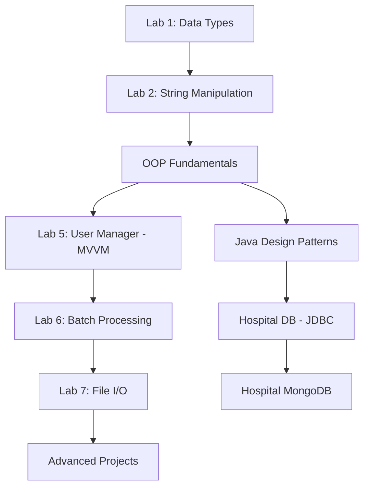

<!-- Dynamic Header -->
<div align="center">
  
  
  
</div>

<!-- Organization Badges -->
<div align="center">

[](https://www.jala.university)
[](https://github.com/JalaU-Labs)
[](https://github.com/orgs/JalaU-Labs/repositories)
[]()

**Practical software engineering education through progressive laboratory exercises**

</div>

---

## 🎯 **Our Educational Philosophy**

JalaU-Labs is the academic laboratory repository for **Jala University**, containing hands-on exercises that bridge theoretical computer science concepts with practical implementation. Each lab represents a stepping stone from fundamental programming to enterprise-grade architecture.

```typescript
const learningPath = {
    fundamentals: ["OOP Principles", "Data Types", "Control Structures"],
    intermediate: ["Design Patterns", "Database Connectivity", "File I/O"],
    advanced: ["MVVM Architecture", "Multithreading", "Cross-Platform UI"],
    outcome: "Industry-ready software engineers with strong architectural thinking"
};
```

---

## 🚀 **Laboratory Series**

###  **Modern Desktop Development**

Progressive C# labs transitioning from console applications to sophisticated cross-platform desktop apps using **Avalonia UI** and **.NET 10/11**.

<table>
<tr>
<td width="50%">

#### 📁 [Lab 7: Import/Export System](https://github.com/JalaU-Labs/Lab7-Avalonia-ImportExport)
**File Persistence & MVVM Architecture**

Desktop application demonstrating file I/O operations using `StreamWriter`/`StreamReader` with modern MVVM patterns.

**Learning Outcomes:**
- 🔹 File persistence techniques
- 🔹 LINQ queries for data manipulation
- 🔹 MVVM architectural pattern
- 🔹 Cross-platform desktop deployment

**Stack:** `C#` `.NET 10` `Avalonia UI` `MVVM`

</td>
<td width="50%">

#### ⚡ [Lab 6: Batch Processing](https://github.com/JalaU-Labs/Lab6-BatchProcessing)
**Multithreading & Performance Optimization**

High-performance data processor for large Steam datasets (CSV) comparing sequential vs. multithreaded approaches.

**Learning Outcomes:**
- 🔹 Parallel processing concepts
- 🔹 Thread management & synchronization
- 🔹 Performance benchmarking
- 🔹 Large dataset handling (GB+)

**Stack:** `C#` `.NET` `Multithreading` `CSV Processing`

</td>
</tr>
<tr>
<td width="50%">

#### 👥 [Lab 5: User Manager](https://github.com/JalaU-Labs/Lab5-UserManager-Avalonia)
**MVVM & LINQ Mastery**

Desktop user management system implementing advanced LINQ queries and custom design patterns within Avalonia UI.

**Learning Outcomes:**
- 🔹 MVVM pattern implementation
- 🔹 Advanced LINQ operations
- 🔹 Custom pattern design
- 🔹 Desktop UI/UX principles

**Stack:** `C#` `Avalonia UI` `MVVM` `LINQ`

</td>
<td width="50%">

#### 🧮 [Calculator.Avalonia](https://github.com/JalaU-Labs/Calculator.Avalonia)
**Multi-Mode Computational Engine**

Professional calculator with Standard and Hexadecimal modes, demonstrating dual-mode architecture and input validation.

**Learning Outcomes:**
- 🔹 Dual-mode application architecture
- 🔹 Hexadecimal computation logic
- 🔹 Avalonia UI data binding
- 🔹 Input validation strategies

**Stack:** `C#` `.NET 10` `Avalonia UI` `MVVM`

</td>
</tr>
<tr>
<td width="50%">

#### 🎮 [Geometric Puzzle](https://github.com/JalaU-Labs/GeometricPuzzle.Avalonia)
**Interactive Game Development**

Drag-and-drop geometry sorting game teaching object interaction and collision detection in desktop environments.

**Learning Outcomes:**
- 🔹 Interactive UI development
- 🔹 Shape manipulation logic
- 🔹 Game state management
- 🔹 Event-driven programming

**Stack:** `C#` `Avalonia UI` `Game Logic` `.NET`

</td>
<td width="50%">

#### 🧱 [OOP Fundamentals](https://github.com/JalaU-Labs/OOP-Fundamentals-CSharp)
**Four Pillars of Object-Oriented Programming**

Comprehensive educational project demonstrating Abstraction, Encapsulation, Inheritance, and Polymorphism with Java comparisons.

**Learning Outcomes:**
- 🔹 OOP principles in practice
- 🔹 C# vs Java paradigm differences
- 🔹 Data structure implementations
- 🔹 SOLID foundations

**Stack:** `C#` `OOP` `Data Structures` `.NET`

</td>
</tr>
<tr>
<td width="50%">

#### 💻 [Programming 3 - Lab 2](https://github.com/JalaU-Labs/Programming3-Lab2)
**String Manipulation & OOP**

Console-based exercises focusing on string operations and object-oriented foundations.

**Stack:** `C#` `String Processing` `OOP`

</td>
<td width="50%">

#### 🔤 [Programming 3 - Lab 1](https://github.com/JalaU-Labs/Programming3-Lab1)
**Data Type Conversions**

Fundamental console application exploring type systems and conversions in .NET 8.

**Stack:** `C#` `.NET 8` `Type System`

</td>
</tr>
</table>

###  **Enterprise Java & Design Patterns**

<table>
<tr>
<td width="50%">

#### 🗳️ [Electronic Voting System](https://github.com/JalaU-Labs/electronic-voting-system)
**Data Structures in Practice**

Comprehensive e-voting implementation using `LinkedHashMap` for ordered vote counting and `HashSet` for duplicate prevention.

**Learning Outcomes:**
- 🔹 Hash-based data structures
- 🔹 Vote integrity & validation
- 🔹 Maven build management
- 🔹 JDK 24 modern features

**Stack:** `Java 24` `Maven` `LinkedHashMap` `HashSet`

</td>
<td width="50%">

#### 🏥 [Hospital Database App](https://github.com/JalaU-Labs/hospital-db-app)
**JDBC & DAO Pattern**

Enterprise database connectivity demonstrating Data Access Object pattern, Singleton, and ORM investigation.

**Learning Outcomes:**
- 🔹 JDBC connectivity
- 🔹 DAO architectural pattern
- 🔹 Singleton implementation
- 🔹 SQL vs ORM comparison

**Stack:** `Java 21` `JDBC` `DAO Pattern` `Singleton`

</td>
</tr>
<tr>
<td width="50%">

#### 🍃 [Hospital MongoDB](https://github.com/JalaU-Labs/hospital-mongodb-java)
**NoSQL Fundamentals**

Java 21 + Gradle project exploring document-based databases and CRUD operations in MongoDB.

**Learning Outcomes:**
- 🔹 NoSQL document modeling
- 🔹 MongoDB Java Driver
- 🔹 SQL vs NoSQL decision making
- 🔹 Gradle build system

**Stack:** `Java 21` `MongoDB` `Gradle` `NoSQL`

</td>
<td width="50%">

#### 🎨 [Design Patterns](https://github.com/JalaU-Labs/design-patterns-java)
**Creational & Behavioral Patterns**

Reference implementations of Gang of Four patterns demonstrating code reusability and design stability.

**Learning Outcomes:**
- 🔹 Factory & Builder patterns
- 🔹 Observer & Strategy patterns
- 🔹 Pattern selection criteria
- 🔹 Design stability principles

**Stack:** `Java 21` `Design Patterns` `OOP`

</td>
</tr>
</table>

---

## 🛠️ **Technology Curriculum**

<div align="center">

### **Language Progression**


### **Architecture & Patterns**
```
✅ MVVM (Model-View-ViewModel)     ✅ DAO (Data Access Object)
✅ Singleton Pattern               ✅ Repository Pattern
✅ SOLID Principles                ✅ Multithreading & Concurrency
```

### **Database Technologies**


### **UI Frameworks**


</div>

---

## 📚 **Learning Pathways**

### **For Students: Recommended Sequence**



### **Skill Acquisition Map**

| Semester | Focus Area | Key Technologies | Complexity |
|----------|-----------|------------------|------------|
| **Foundation** | OOP Principles | Java/C# Basics | ⭐⭐ |
| **Intermediate** | Desktop UI & Patterns | Avalonia, MVVM, LINQ | ⭐⭐⭐ |
| **Advanced** | Concurrency & Data | Multithreading, NoSQL | ⭐⭐⭐⭐ |
| **Expert** | Architecture & Integration | Full-stack, APIs | ⭐⭐⭐⭐⭐ |

---

## 🎓 **Educational Standards**

Every laboratory in this organization adheres to:

✅ **Progressive Complexity** - Each lab builds upon previous concepts  
✅ **Industry Relevance** - Technologies used in current enterprise environments  
✅ **Clean Code** - Consistent formatting, meaningful naming, proper documentation  
✅ **Architectural Thinking** - Beyond syntax: design patterns and system design  
✅ **Cross-Platform Awareness** - Solutions that work across operating systems  

---

## 🤝 **Contributing & Academic Integrity**

We encourage collaboration and learning:

- **Fork & Experiment**: All labs are starting points—extend them!
- **Report Issues**: Found a bug? Open an issue to help improve the curriculum
- **Documentation**: Improvements to explanations and READMEs are always welcome
- **Feature Extensions**: Add new modes to the calculator, new puzzles to the geometric game, etc.

**Note**: These are educational resources. While we welcome contributions that enhance learning value, please respect academic integrity guidelines if using these for coursework.

---

## 📞 **Connect & Learn More**

<div align="center">

[](mailto:Alejandro.Botina0125@jala.university)
[](https://github.com/orgs/JalaU-Labs/repositories)
[](https://github.com/JalaU-Capstones)

</div>

---

<div align="center">

### 🧪 **Laboratory to Industry**

*Mastering fundamentals today, architecting solutions tomorrow*


</div>